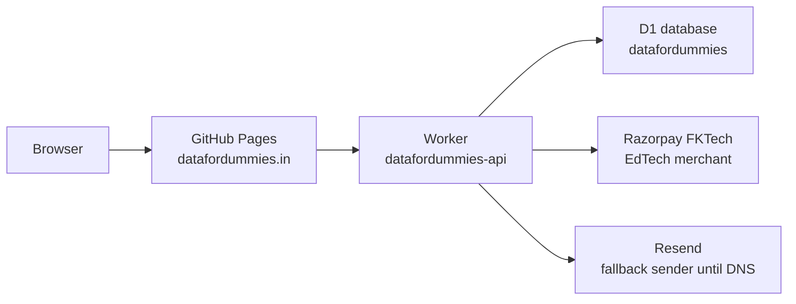

# Data For Dummies — architecture guide

Written 12 October 2026 so a different AI on a different computer can work without this chat.

Read this file, then `AGENTS.md`. The README still contains older FKTI notes underneath a corrected header. Trust this file when they disagree.

## What it is

Data For Dummies is a static learning site for data analytics and data engineering. A visitor can open course pages, practice, and (when the database is awake) sign in and pay for Pro. The pages are hand-written HTML, CSS, and JavaScript. There is no React app and no build step.

Live brand: **Data For Dummies**. The code still contains the older name FKTI in storage keys and email copy. Do not rename `fkti_analytics` in `localStorage`. The homepage does not initialize Firebase.

It is not FunBerry Kids and it is not Okavo.

## Live addresses

| Surface | Address | Status on 12 Oct 2026 |
|---------|---------|------------------------|
| Website | https://datafordummies.in | HTTP 200. |
| www | https://www.datafordummies.in | Redirects to the apex. CNAME is `fkhambaty.github.io`. |
| GitHub | https://github.com/fkhambaty/datafordummies | This repository is the website. |
| Old repo name | `fkhambaty/fkti_data` | Mentioned in old docs. The footer used to link there. The live repository is `datafordummies`. |

Hosting is **GitHub Pages**, not Vercel. The DNS `A` records are GitHub Pages (`185.199.108.153` through `185.199.111.153`). The file `CNAME` contains `datafordummies.in`. Pushing `main` publishes the site. There is no Vercel project to configure for this domain unless the owner deliberately moves it.

The domain itself is registered at GoDaddy. API keys for DNS changes are created at https://developer.godaddy.com/keys.

## How a page works



The pages in this repository are the site. Accounts, progress, and Pro state go to `https://datafordummies-api.fkhambaty.workers.dev`, then to the D1 schema in `cloudflare/d1`. Razorpay is the FKTech EdTech merchant, shared only with FunBerry Kids. Okavo is not on this merchant. Signup and reset mail use Resend, and `datafordummies.in` is still unverified there.

New accounts do not use Supabase. Signup emails a 6-digit code. The account cannot log in until `auth/verify.html` accepts that code. `auth/reset-password.html` emails a reset code and sets a new password. Codes expire after 15 minutes and allow 5 tries. Email goes through Resend: the worker secret is `RESEND_API_KEY` and the sender is `MAIL_FROM` in `wrangler.toml`. Without the secret, signup and reset return 503 on purpose.

`datafordummies.in` is not verified in Resend yet; its DNS zone is in a Cloudflare account the deploy token cannot edit. Until the four Resend records exist, Resend refuses `MAIL_FROM`, so the Worker resends the same code from `MAIL_FROM_FALLBACK` (`Data For Dummies <no-reply@funberrykids.in>`, a verified FKTech education domain) with reply-to `fktiindia@gmail.com`. When the domain verifies, `MAIL_FROM` succeeds first and the fallback stops being used. `GET /v1/health` reports `email_sender` as `primary`, `fallback`, or `none`. The weekly smoke check fails on `none`.

Test login: username `dummy`, password `dummy`. It is an already-confirmed student account, never an admin. Delete it with `DELETE FROM profiles WHERE id = 'dummy-test-account'` if the site should not have it. The public config is `window.DFD_API` in `js/supabase-config.js`. Do not put the Cloudflare API token in that file.

## Repository map

Root `*.html` files are the hub: home, pricing, learning path, projects, founder, and the standalone tools (pipeline designer, data adventure, data modelling, distributed computing).

Course folders, each with its own `index.html` and usually a `hub.html`:

| Folder | Subject |
|--------|---------|
| `python_course/` | Python for data science. Fifteen sessions. Sessions 13 and 14 are the visualization lessons. |
| `data_science_course/` | Data science and ML. `styles.css` imports the shared course theme. |
| `postgres_course/` | PostgreSQL |
| `mssql_course/` | Microsoft SQL Server |
| `airflow_course/` | Apache Airflow |
| `dbt_course/` | dbt |
| `clickhouse_course/` | ClickHouse |
| `redshift_course/` | Amazon Redshift. The hub lessons are canonical. `index.html` stays as the older single-page course and links to those lessons. |
| `metabase_course/` | Metabase. Hub lessons use the shared shell. Meet Metabase is free. The other eight lessons are Pro. |
| `kubernetes_course/` | Kubernetes. Hub at `hub.html`. `index.html` keeps the old section addresses and links to the lessons. Twelve lessons: Meet Kubernetes and Local clusters are free. The other ten set `data-access="pro"`. |
| `terraform_course/` | Terraform and OpenTofu. Hub at `hub.html`. `index.html` keeps the old section addresses, including `#workspaces`. Twelve lessons: the intro and the install lesson are free. The other ten are Pro. |
| `llm_course/` | Large language models. `styles.css` imports the shared course theme. Page animations stay in each lesson. |
| `dms_course/` | AWS DMS. `hub.html` and `index.html` are the same course map. Eleven lessons: architecture and assessments are free. The other nine are Pro. |
| `snowflake_course/` | Snowflake. Hub at `hub.html` (also copied to `index.html`). Lessons use `styles.css`, which imports `course-light-theme.css`. Two lessons are free (`meet-snowflake`, `trial-account`). The other eleven set `data-access="pro"`. |
| `interviews/` | Interview practice, including a free `snowflake-interview.html` |

`js/hub-script.js` function `enterCourse` is the old router from the home page into a course `hub.html`. Footer links should also have a real `href`, so the course opens when JavaScript does not.

`cloudflare/d1` is the live database schema and migrations. `cloudflare/worker` owns accounts, progress, analytics, admin data, and payments. `supabase/` is retained only as retired history; its edge functions and database are not deployed dependencies. `admin/` is the private analytics view and requires an authenticated owner profile.

`python_course/student-assignments.html` is the student practice (anchors `assignment1` through `assignment5`). `a1-strings.html` and its siblings are solution pages, not the student links. Do not point the student cards at the solution files.

## Payments and accounts

Pro subscriptions use the **FKTech EdTech Razorpay account**, shared only with FunBerry Kids. Okavo is a marketplace and requires a separate merchant account. Data For Dummies has its own weekly and monthly plan ids and its own webhook secret. Secrets live only in Cloudflare Worker secrets. Public plan ids and the live key id are Worker vars.

The Worker creates a subscription with notes tying it to the signed-in D1 profile, verifies every payment or webhook signature, fetches the subscription from Razorpay, and grants Pro only when Razorpay reports `active` or `authenticated`. D1 stores subscription state, captured charges for revenue reporting, and webhook event ids for idempotency. `/v1/profile` reconciles pending or expired subscriptions directly with Razorpay, so renewal does not depend on webhooks.

`CHECKOUT_MODE = "hosted"` is the production default while `datafordummies.in` awaits Razorpay website approval. The browser follows Razorpay's subscription `short_url`; returning to the profile causes server-side reconciliation. After Razorpay approves the website, set the Worker var to `modal` and deploy. Modal checkout is branded **FKTech** and falls back to the hosted URL if the embedded checkout is blocked or reports a website/domain error.

The old Supabase `create-subscription`, `razorpay-callback`, `razorpay-webhook`, and `get-analytics` functions are retired. Do not revive or call `gfskxboxvzuwozknfulo.supabase.co`.

Contact addresses published on the site: `fktiindia@gmail.com` and `fakhruddinkhambaty@gmail.com`. There is no Discord server and no discussion forum. Do not add those links back as `href="#"`.

## Design system

`css/dfd-system.css` owns shared tokens, keyboard focus, reduced motion, and overflow guards. Every static HTML page links it last inside `<head>`, with a relative path (`css/dfd-system.css` at the root, `../css/dfd-system.css` one folder down). Checked 13 October 2026: 267 pages, one link each, every path resolves.

Family styles sit in front of that file. They own color and layout. The system file must not repaint them.

| Family | Stylesheet | Pages |
|--------|------------|--------|
| Marketing | `css/fkti-light-theme.css`, `css/hub-styles.css`, `styles/ui-upgrade.css` | Home, learning path, founder, projects index, and pages that already share that nav |
| Course hubs | `css/hub-light.css` | Course `hub.html` files, including Kubernetes, Terraform, and AWS DMS. Each hub sets `--hub-color` and `--hub-color2` |
| Shared lesson shell | `css/course-light-theme.css` | Lessons whose `styles.css` imports it, including PostgreSQL, SQL Server, ClickHouse, Metabase, Redshift, Kubernetes, Terraform, and AWS DMS |
| Python | `python_course/light-theme.css` | Python lessons. October 2026 pass: 15-session nav, visualization on sessions 13 and 14, shared progress and knowledge checks. |
| Data science | `data_science_course/styles.css` | Imports `css/course-light-theme.css`. Lesson pages keep their own `<style>` blocks for diagrams. |
| LLM | `llm_course/styles.css` | Imports `css/course-light-theme.css`. Page animations stay in each lesson's `<style>` block. |
| Airflow | `airflow_course/styles.css` | Imports `css/course-light-theme.css`. Page `<style>` blocks keep diagrams. Framed for Airflow 3.3.2. |
| dbt | `dbt_course/styles.css` | Imports `css/course-light-theme.css`, then dbt colors. Framed for dbt v2 / Fusion and Core. |
| ClickHouse | `clickhouse_course/styles.css` | Imports `css/course-light-theme.css`. Framed for current MergeTree, JSON, and Cloud storage. |
| Accounts | `styles/design-system.css`, `styles/auth.css` | `auth/` |
| Pricing | `styles/pricing.css` | `pricing.html` |
| Project walkthroughs | `css/project-pages.css` | `projects/*.html` |
| Admin | `css/dfd-admin.css` | `admin/analytics.html` only |
| Tools | `css/dfd-tools.css` | `pipeline-designer.html`, `data-modelling.html`, `bus-matrix.html`, `distributed-computing.html` |

Data science, LLM, Airflow, and dbt lessons link a family `styles.css` and still carry their own `<style>` block for diagrams and accents. ClickHouse lessons use the family stylesheet. Do not replace those blocks with a blanket theme.

### Safe extension rules

- A new page links `dfd-system.css` with the correct relative path. It does not copy the token list into a new file.
- New rules in `dfd-system.css` use `:where()` or stay limited to focus, reduced motion, and overflow. The file loads after inline `<style>`, so a normal class selector would override lesson colors.
- Course accent colors stay in the course stylesheet or that page's own `:root`.
- Do not restyle `.keyword`, `.string`, `.comment`, `.function`, `.number`, `.type`, or `.operator`. Lessons paint those as inline spans.
- Do not rename `FKTI_Auth`, any `fkti_` storage key, or the published address `fktiindia@gmail.com`. Visible "FKTI" labels may say Data For Dummies. Do not load the Firebase SDK or the Supabase browser SDK.
- Do not rename classes that course JavaScript or the paywall reads, including hub cards, lesson nav, quiz options, and code-copy buttons.
- Do not set `display` on `[data-access]`, `.paywall`, `.pro-lock-overlay`, `.pro-locked-wrapper`, `.dashboard`, `.auth-gate`, or `.admin-signin-overlay`. Signup verification, progress, code copy, the paywall, and Razorpay stay wired as they are.
- Do not put `overflow` on `html` or `body` in the shared file. That forces the other axis off `visible` and breaks fixed menus and modals.

### Responsive matrix

The nav breakpoint is **768px**. `css/dfd-system.css`, `css/hub-styles.css`, and `js/hub-script.js` all use `@media (max-width: 768px)` / `matchMedia('(max-width: 768px)')`. Widths 721–768 are the mobile menu. Do not bring back a 720px cutoff, and do not branch the menu on `innerWidth > 768` (a scrollbar makes that disagree with CSS). Tool workspaces in `css/dfd-tools.css` wrap from 860px down, which already includes the 768px menu.

Target viewports: 390×667, 390×844, 768×1024, 820×1180, 1024×768, and 1440×900.

The page itself never scrolls sideways. Wide tables, code, and media scroll inside their own box. `table` at 768px and below is `display: block` with `overflow-x: auto`. Rows and cells keep table layout inside it. Do not set `display` on `thead`, `tbody`, `tr`, or cells. `pre` and `.code-block` keep `white-space: pre` and scroll horizontally. Do not clip a lesson with `overflow: hidden` on `html` or `body`.

Fixed nav, footer, and the paywall, contact, and admin modals use `env(safe-area-inset-*)`. Key actions (menu, primary buttons, quiz choices, copy, tool controls) are at least 48px on the short side at 768px and below. Text inputs, selects, and textareas are 16px at 1024px and below so iOS does not zoom the page. `prefers-reduced-motion: reduce` shortens animation and transitions.

`viewport-fit=cover` stays on the viewport meta together with `width=device-width, initial-scale=1.0`.

- The filename `css/fkti-light-theme.css` stays. Renaming it would break every existing link.

## Lesson foundation

Added 13 October 2026. These files are the shared shell for new lessons. Existing course HTML was not rewritten to use them, apart from `viewport-fit=cover` on the viewport meta (the previous `width=device-width, initial-scale=1.0` content stays).

| File | Role |
|------|------|
| `js/lesson-common.js` | Opt-in reveal (`[data-dfd-reveal]`), back-to-top only when the page has no `.back-to-top` or `#backToTop`, and progress through `FKTI_Progress` / `FKTI_Auth` when `data-course-id` and `data-lesson-id` are both set. No ids or no API: no-op. |
| `js/quiz.js` | Opt-in `[data-dfd-quiz]` checks. Does not bind old `checkQuiz`, `checkQ`, or `[data-quiz]` markup. |
| `templates/lesson-shell.html` | Copy-from page. Not a hub lesson. |
| `docs/LESSON_SHELL.md` | CSS and script order. |
| `scripts/verify_site.py` | Crawls HTML. Baseline stubs and known missing anchors are warnings. A `hub.html` course map is not treated as a lesson stub. New breaks exit 1. |
| `scripts/viewport_audit.mjs` | Playwright pass for HTTP errors, console errors, page errors, document overflow, the 768px menu, and 16px inputs. `--mode sweep` covers every page at 390, 768, and 1440. `--mode full` covers representative routes at all six viewports. `--mode clicks` walks the menu, video, hubs, lessons, dummy login, and tools. `--mode all` runs those three. Local `/v1/page-view` and `/v1/event` calls return 204 so CORS noise is not a failure. |

Head order for a new lesson: the family stylesheet, then the page accent, then `dfd-system.css` last. Script order: `code-copy.js`, `supabase-config.js`, `supabase-auth.js`, `paywall.js`, `progress.js`, `lesson-common.js`, `quiz.js`, `analytics-tracker.js`. Do not load the Supabase CDN. `supabase-auth.js` talks to the Worker. Do not load `hub-script.js` on a lesson. It already owns the home-page nav and scroll handlers.

`css/course-light-theme.css`, `css/hub-light.css`, and `css/dfd-system.css` gained additive `.dfd-*` classes for diagrams, knowledge checks, progress, 48px targets, safe-area padding, and scrolling tables, SVG, and code. Syntax color classes and paywall `display` rules are unchanged.

`snowflake_course/` is the first course built on that shell. Each lesson sets `data-course-id="snowflake"` and its own `data-lesson-id`. `css/dfd-system.css` is last. Scripts are `code-copy.js`, the account and paywall files, `progress.js`, `lesson-common.js`, and `quiz.js`. The mark in `snowflake_course/logo.svg` is an original hexagon, not the Snowflake Inc. logo.

Metabase, the Redshift hub lessons, the PostgreSQL replication lesson, and the SQL Server practice-dataset page use the same shell. Redshift's canonical URLs are the files linked from `redshift_course/hub.html`. `redshift_course/index.html` remains the older single-page course and points at those lessons. Meet Metabase and Meet Redshift stay free. The other hub lessons in those two courses are Pro.

Checked 13 October 2026, the Python, data science, and LLM families use that same progress and knowledge-check script. Python sessions 13 and 14 teach matplotlib/seaborn and enhanced charts. `python_course/a4-functions.html` is the function solutions page for `student-assignments.html#assignment4`. Data science `index.html` is the course hub: every card links a real lesson or a section on that hub. LLM lessons distinguish the 2019 GPT-2 decoder from ChatGPT, and the deployment lesson uses a LangChain runnable instead of `RetrievalQA`. Access flags are unchanged.

Checked 13 October 2026, the Airflow, dbt, and ClickHouse families use the same shell. Each family `styles.css` imports `css/course-light-theme.css`. Lesson pages keep their own `<style>` blocks for diagrams. Airflow lessons are framed for Apache Airflow 3.3.2 (17 September 2026): `airflow.sdk`, Assets (the rename of Datasets), TaskFlow `@task` as the default, provider packages, deferrable operators, data intervals, dynamic task mapping, and DAG bundles. `PythonOperator` stays as migration context. The 75-question certification pages are a course practice set, not an Apache Software Foundation exam and not an Astronomer certification. dbt lessons are framed for the October 2026 Developer Hub: `dbt build`, unit tests, contracts, groups, access, versions, the Semantic Layer, Mesh, and `state:modified` with `--defer`. The `dbt` package is the Fusion v2 engine (self-hosted channel v2.0.8 on that check). `dbt-core` remains the Apache-licensed runtime. Fusion is generally available for dbt platform projects on Snowflake, with other adapters still preview or beta, and local lifecycle can lag the platform. ClickHouse lessons use current MergeTree practice, the JSON type (production-ready since 25.3), projections, incremental and refreshable materialized views, SharedMergeTree on Cloud, Iceberg and Delta reads, Kafka-to-MergeTree ingestion, `argMax` instead of `FINAL` on large tables, and ClickHouse Keeper. `airflow_course/index.html`, `dbt_course/index.html`, and `clickhouse_course/index.html` stay at those URLs. Free and Pro flags are unchanged: Meet Airflow, Meet dbt, and Meet ClickHouse are free. The other hub lessons are Pro.

Checked 13 October 2026, the PostgreSQL, SQL Server, Redshift, and Metabase families use that same shell. Each family `styles.css` imports `css/course-light-theme.css`. PostgreSQL lessons are framed for the supported majors on that date: 18 is current (18.6), 17, 16, and 15 remain supported, and 14 is supported until 12 November 2026. PostgreSQL 19 was still a beta, with a final release planned for 19 November 2026, so the lessons do not teach it as available. The pages cover psql and DBeaver, SQL null semantics, `MERGE` beside `ON CONFLICT`, JSON and JSONB including `JSON_TABLE` from PostgreSQL 17, arrays, indexes including BRIN, partitioning, isolation and deadlocks, logical and physical replication, a `pgvector` introduction that links to the LLM embeddings lesson, and monitoring, backups, security, and managed-service limits. Meet PostgreSQL and Installation stay free. The other twelve lesson pages are Pro. `postgres_course/index.html` remains the section index and links the replication lesson.

SQL Server lessons are framed for the lifecycle on that date. SQL Server 2016 extended support had ended on 15 July 2026. SQL Server 2017, 2019, 2022, and 2025 were the supported majors. SSMS 22 (22.10.2, 28 September 2026) and SSMS 21 support SQL Server 2025. The pages treat `MERGE` with Microsoft's warning and show an update-then-insert upsert, distinguish the native `json` type (generally available on Azure SQL under the SQL Server 2025 or Always-up-to-date policy, preview on SQL Server 2025) from `nvarchar` JSON on SQL Server 2022, and cover columnstore, temporal tables, Query Store, Entra authentication for Azure SQL, and backup and restore. Microsoft Fabric is named as a different product. The course does not teach it and does not treat a lesson as Fabric experience. Meet SQL Server and the course practice page stay free. The other twelve lesson pages are Pro. `mssql_course/certification-hub.html` is course practice, not a Microsoft certification. `mssql_course/index.html` stays the module index.

The Redshift and Metabase hub lessons were already on the shell. This pass checked them against October 2026 docs and left sound explanations in place. Redshift lessons keep the caveats on zero-ETL, data sharing, AUTO table design, RA3, Serverless, automatic WLM, Spectrum, and Iceberg. The older `redshift_course/index.html` no longer tells a new warehouse to start on DC2. Metabase lessons keep Cloud and self-host, embedding, models and metrics, permissions, and upgrades. The older Metabase index no longer shows a published application-database password, an H2 install as the way to keep data, or PostgreSQL 13 for that database. Meet Redshift and Meet Metabase stay free. The other eight lessons in each course are Pro.

Snowflake was audited for navigation, Pro labels, lesson counts, and factual caveats. Thirteen lessons, two free and eleven Pro, and the next and previous links already matched the hub. No content rewrite.

Checked 13 October 2026, Kubernetes, Terraform, and AWS DMS moved off single-page courses onto the same shell. Each lesson sets `data-course-id` and `data-lesson-id`, loads `dfd-system.css` last, and uses the shared progress, quiz, and code-copy scripts. Family `styles.css` imports `css/course-light-theme.css`. Diagrams are inline SVG with step buttons. There are no screenshot placeholders.

Kubernetes is twelve lessons. Meet Kubernetes and Local clusters are free. The other ten are Pro. Local setup covers kind, minikube, and Docker Desktop on macOS, Windows, and Linux. Lessons do not pin one patch release: minor branches move about every four months and are maintained for about 14 months. Ingress stays a stable API that needs a controller. Gateway API is a separate CRD project; the 1.5 release notes say Kubernetes 1.30 or later for that release, and a later Gateway API release can raise the floor. NetworkPolicy is described as unenforced on default kind. PodSecurityPolicy is described as removed in 1.25. EKS, GKE, and AKS prices are left to each cloud's current price page. `kubernetes_course/index.html` keeps the old section ids (`welcome`, `what-is-k8s`, `install-docker-mac`, `pods`, `deployments`, `services`, `configmaps-secrets`, `kubectl`, `real-apps`) as a map onto the lessons. The hub is `hub.html`.

Terraform is twelve lessons. The intro and the install lesson are free. The other ten are Pro. CLI workspaces and HCP Terraform workspaces are taught as different objects. `terraform_course/index.html#workspaces` is that pointer. S3 locking is described as version-dependent: current HashiCorp docs use `use_lockfile`, older releases used DynamoDB, and OpenTofu has its own backend page. OpenTofu is a separate MPL project. The lessons do not say it includes HCP Terraform, Sentinel, or every later Terraform flag. `terraform_course/index.html` keeps the old section ids and links to the lessons.

AWS DMS is eleven lessons. Architecture and the assessment lesson are free. The other nine are Pro. Premigration assessment, DMS Schema Conversion, and the desktop AWS SCT are three different reports. Replication instances and DMS Serverless are both described as current choices. Serverless idle billing is left to the current pricing page. `dms_course/index.html` and `hub.html` are the same map, replacing the old launching-soon page. There were no old lesson anchors to keep.

Home tools, the footer, the learning path, the curriculum, `enterCourse` in `js/hub-script.js`, and the profile progress links open the three hubs. The first two lessons of each course are free. Pro lessons set `data-access="pro"`.

## Local run

Open `index.html` in a browser, or serve the folder:

```bash
python3 -m http.server 8877
python3 scripts/verify_site.py --self-test
python3 scripts/verify_site.py
node scripts/viewport_audit.mjs --base http://127.0.0.1:8877 --mode all
# or: scripts/check_viewports.sh all
```

`scripts/check_viewports.sh` accepts `sweep`, `full`, `clicks`, or `all`. The audit reads Playwright from `PLAYWRIGHT_MODULE` or `/Users/fakhruddinkhambaty/product-reviews/okavo/node_modules/playwright/index.js`. No package install is part of this site. It answers `/v1/page-view` and `/v1/event` with 204. On a loopback base it turns web security off so the dummy account (`dummy` / `dummy`, lifetime Pro, no charge) can sign in before the worker is deployed. `cloudflare/worker/src/index.js` allows any `http://127.0.0.1` or `http://localhost` origin; that list reaches production only after `wrangler deploy`. A change to the pages is live only after it is pushed to `main` and GitHub Pages finishes.

## What not to get wrong

- Do not move the site to Vercel as a drive-by. The domain points at GitHub Pages on purpose.
- The homepage must not invent learner counts, employer logos, testimonials, or project totals. Course folders and project pages that exist in this repo can be named. A number that was not counted from the repo does not go on the page.
- The homepage footer used to link GitHub at `fkhambaty/fkti_data` and the five Python assignment cards linked `student-a1.html` through `student-a5.html`, which were 404s. Those now point at this repository and at `student-assignments.html#assignmentN`.
- Visual changes go through the design-system table above. Do not find-and-replace course HTML class names, syntax spans, or payment scripts to chase a new look.

## Trust, completion, and operations (13 October 2026)

`scripts/build_learning_platform.py` writes `robots.txt`, `sitemap.xml`, `data/course-catalog.json`, and `cloudflare/worker/src/course-catalog.js`. It stamps one description, canonical URL, and Open Graph block on every HTML page. The homepage carries Organization structured data. Each course hub carries Course structured data with the provider and the hub text. There is no rating and no learner count in that data. `scripts/verify_site.py` fails if a page loses those tags, if two descriptions match, if the sitemap drifts from the HTML inventory, if the Supabase CDN or Firebase init returns, or if the APK binaries return.

`privacy.html`, `terms.html`, `cancellation.html`, and `refunds.html` are linked from the homepage footer, pricing, signup, and the account page. Cancellation stops the next Razorpay renewal. A captured payment is not refunded automatically.

The free plan offers the YouTube channel, the GitHub repository, and email. There is no private forum. Pro copy does not promise a job, a 12-week portfolio, priority support, or that the Android app shares the website subscription.

`POST /v1/progress/complete` saves one catalog lesson with the server clock. A client-sent `completed_lesson_ids` list on `PUT /v1/progress` does not count. `POST /v1/certificates` creates a row with status `requested` and `issued_at` null only when every catalog lesson for that course is in `lesson_completions`. The account page shows that evidence. Nothing in this repository issues a certificate or prints a verification URL. Old course scripts that built a downloadable certificate now send the reader to the account page.

Hub pages load `js/hub-learning.js`. Reading time is the lesson word count divided by 180, clamped between 4 and 40 minutes. Prerequisites, outcomes, and the capstone note come from `data/course-catalog.json`.

`/v1/page-view` records `course_view` for a course hub and `pro_page` for pricing. Signup, the first saved lesson, checkout creation, and an active subscription are recorded by the Worker. The admin analytics page shows those six counts. `cloudflare/d1/funnel_query.sql` is the same query. Event payloads do not include the email address.

`GET /v1/health` reports `email_ready` as a boolean. It does not return secrets. Signup still returns 503 when Resend is not configured, and that path does not insert an account.

`docs/VENDOR_REFRESH.md` is the checklist. `python3 scripts/check_vendor_versions.py` fails when the stamp is older than 90 days. `--online` compares the stamped Airflow major version with PyPI.

`snowflake_course/index.html` and `dms_course/index.html` were byte-for-byte copies of their hubs on 13 October 2026. They are now compatibility redirects to `hub.html`. Other old index pages were not byte-identical, so they stayed. The Android binaries were removed. `docs/APK_RELEASE.md` points at the Google Drive folder already used in the navigation. `apk/index.html` opens that folder.

`.github/workflows/ci.yml` runs the site verifier, the vendor stamp check, and the Worker tests. `.github/workflows/production-smoke.yml` runs every Monday against the live site: homepage, `/v1/health`, the existing dummy login, a payment call that must be refused, and homepage width at 390 and 1440. It does not create an account.

Pushing `main` still publishes the static site through GitHub Pages. The Worker is published with `npx wrangler deploy` from `cloudflare/worker` after `004_completion_certificates.sql` is applied to the remote D1 database. `CHECKOUT_MODE` stays `hosted` until Razorpay approves the domain.

## If this computer is gone

`https://github.com/fkhambaty/datafordummies` is the copy that matters. It contains this guide, `AGENTS.md`, the HTML, the Worker, the D1 schema, and `cloudflare/worker/wrangler.toml`. Clone it on another computer and the site can be read and redeployed.

These names are Worker secrets and are not stored in Git: `RESEND_API_KEY`, `RAZORPAY_KEY_SECRET`, and `RAZORPAY_WEBHOOK_SECRET`. They remain in the Cloudflare Worker even if this laptop is lost. A local copy under `~/.config/fk-products/` is only a convenience and must never be committed. Public values that are safe in Git are the key id `RAZORPAY_KEY_ID` and the two plan ids in `wrangler.toml`.

