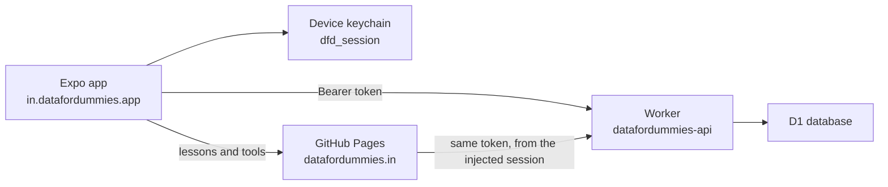
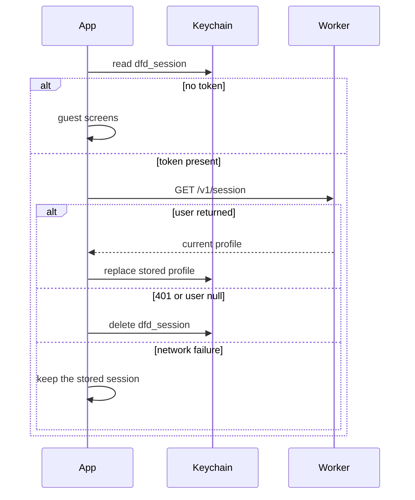
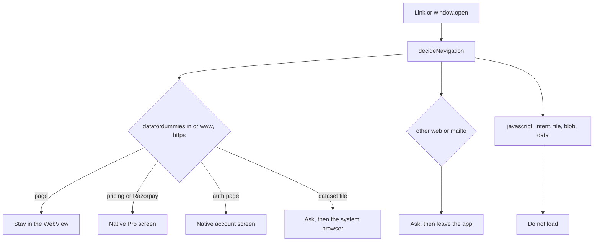

# Data For Dummies mobile architecture

Written 14 October 2026. The website map is [`ARCHITECTURE.md`](../ARCHITECTURE.md). This file is only the phone app in [`mobile/`](../mobile/).

## What it is

An Expo SDK 57 app (React Native 0.86, React 19.2) for iOS and Android. The package id and the iOS bundle id are `in.datafordummies.app`. The URL scheme is `datafordummies`.

The app is a native shell around the existing site:

- Onboarding, sign-in, sign-up, email-code confirmation, password reset, course list, progress, completion records, and the Pro explanation are native screens.
- Lesson pages, course hubs, tools, interview practice, projects, and the four legal pages open in a WebView. Those pages are still the HTML on GitHub Pages. The app does not copy them.

There is no second account system and no second payment system.

## Session

The Worker issues one opaque token from `POST /v1/login` and `POST /v1/verify`. `createSession` in the Worker stores only the SHA-256 of that token and expires it after 30 days. There is no refresh token and no rotation. Signing out deletes that hash. Resetting the password deletes every session for the account.

The app stores `{ token, user }` in `expo-secure-store` under the key `dfd_session`. That is the same object `js/supabase-auth.js` writes to `localStorage`. iOS accessibility is `WHEN_UNLOCKED_THIS_DEVICE_ONLY`, so a backup does not carry the token onto another device. Android backup is off (`allowBackup: false`).

On launch the app reads the keychain and calls `GET /v1/session` with `Authorization: Bearer`. A `user: null` body or a 401 clears the keychain. A network failure keeps the stored session so lessons can still open; the website then gets a 401 from the Worker and shows its own sign-in state. The token is not put in a URL, a WebView query string, or AsyncStorage.

The app calls the Worker with React Native `fetch`, not from a browser page, so the Worker's site allowlist was not widened and no new origin was invented. A phone build still has to confirm sign-in. If that runtime sends an `Origin` the Worker does not list, the account calls fail until the Worker allows it.

Sign-up calls `POST /v1/signup` and does not store a session. The account cannot sign in until `POST /v1/verify` accepts the 6-digit code, which is the same rule as `auth/verify.html`. Codes expire after 15 minutes and allow 5 tries. The resend button waits 60 seconds because the Worker refuses a new code inside that gap. Password reset is `POST /v1/forgot-password` and then `POST /v1/reset-password`. The app does not pretend an email was delivered: the Worker returns the same `{ ok: true }` whether or not the address exists, and the screen says the code is sent only if the account exists.

The dummy account (`dummy` / `dummy`) is a real confirmed student on the server. The app does not special-case it.

## Catalog

`npm run sync:catalog` reads `data/course-catalog.json` and writes `mobile/src/data/catalog.json`. It keeps every course id and lesson id the Worker accepts. It adds three facts the HTML already states and the catalog JSON does not:

- order, from "Module N" / "Session N" labels, then from the first link on the course hub
- free or Pro, from `data-access="pro"` on that lesson's `<body>`
- the hub accent, from `--hub-color`, otherwise `#4f46e5`

Reading time stays the catalog's own estimate: lesson words divided by 180, between 4 and 40 minutes. The app repeats the catalog sentence that this is not a classroom hour. A test fails if the bundled file drifts from the site catalog.

## Lesson and tool WebView

`src/lib/url-policy.ts` decides every top-level navigation and every `window.open`. The WebView's own origin allowlist is `*`, because a native allowlist that rejects a URL asks the operating system to open it. The JavaScript policy is the gate, and it runs first.

| Decision | What happens |
|----------|----------------|
| `https://datafordummies.in` or `https://www.datafordummies.in` page | Loads in the WebView |
| `http://` on those hosts | Reloads the `https://` URL |
| `/pricing` or any Razorpay host | Native "Pro is not sold in this app" screen. The payment page does not load |
| `/auth/login`, `/auth/signup`, `/auth/verify`, `/auth/reset-password`, `/auth/profile` | The matching native screen |
| `.csv`, `.xlsx`, `.sql`, `.zip`, `.pdf` and the other dataset types | Asks, then opens the file in the system browser |
| Any other `https`, `http`, or `mailto` URL | Asks, names the host, then opens it outside the app |
| `javascript:`, `intent:`, `file:`, `content:`, `blob:`, `data:`, and anything else | Blocked. Export buttons that use a blob get the blocked message |

Subframes may load only from the two site hosts. File access, universal file access, mixed content, geolocation, camera and microphone capture, third-party cookies, shared cookies, and the web payment request are off. New windows are off; `onOpenWindow` goes through the same policy. The hardware back button and the swipe-back gesture walk WebView history before leaving the screen.

Before the page scripts run, the app injects `buildSessionScript`. On the two site hosts it sets `localStorage['dfd_session']` to `{ token, user }` or removes it when the app is signed out. The script does nothing on any other host. A profile field is inserted as JSON with `<` escaped, so a name cannot close the script. When the website removes `dfd_session`, the page posts `{ type: 'dfd:signed-out' }` and the app deletes the keychain entry. Messages from any other host are ignored. The page cannot grant Pro, change the token, or send any other command: that is the only accepted message.

`paywall.js` and `lesson-common.js` then behave as they do in a browser. A Pro lesson calls `GET /v1/profile` and shows the lock unless the Worker says the account is Pro or admin. The app does not hide that lock itself.

## Progress and completion records

Marking a lesson complete uses the page's own button, which calls `POST /v1/progress/complete`. The Worker counts a lesson only when its id is in the catalog. The Home, course, and Account screens read `GET /v1/progress`.

A completion record is `POST /v1/certificates`. The Worker creates a row with status `requested` and `issued_at` null, and only when every catalog lesson for that course is in `lesson_completions`. The app shows that status. It does not issue a certificate and it does not show a verification URL, because the website does not either.

## Pro

The app has no checkout, no price, and no Razorpay script. `src/` does not contain the live key id, a plan id, or a call to `/v1/payments/razorpay/subscriptions`.

An account that already has Pro on the website is Pro here, because both clients read the same profile. The rule matches `js/paywall.js` and `isActiveProfile` in the Worker: status `active` or `pro`, and `subscription_end_date` either empty or still in the future. Admin accounts are open. A cancelled subscription stays open until that date, and the screen says it will not renew.

Buying Pro is a website action. App Store guideline 3.1.1 (guidelines dated 8 June 2026) and Google Play's payments policy require their own billing for a digital subscription sold inside an app. This app does not sell one. It also does not link out to the website checkout. Store submission is a separate decision, written in [`MOBILE_RELEASE.md`](MOBILE_RELEASE.md).

## Design

Native screens use the tokens from `css/dfd-system.css`: ink `#0f172a`, accent `#4f46e5`, the same danger and success colours, 16px radius, and the Outfit font. Buttons and fields are at least 48px on the short side. Inputs are 17px so iOS does not zoom. The icon, the Android adaptive layers, and the splash image are cropped from `logo.png`.

## What is deliberately absent

- No in-app purchase and no receipt validation. Adding either needs a real store product id from the owner.
- Account deletion is `DELETE /v1/account`. The signed-in person must send the current password and the confirmation phrase `DELETE`. The Worker then stops an active Razorpay subscription, and only after that succeeds deletes the account's sessions, progress, lesson completions, completion requests, email codes, subscription rows, payment rows, and page and event rows tied to that account, in one D1 batch. Visitor rows stay, with the account link removed. Webhook event ids stay, because they have no account id and stop a charge being applied twice. The app clears the keychain only after the Worker returns success. The demo account `dummy` cannot be deleted. The website profile page does not offer this action yet.
- No universal links. `https://datafordummies.in/...` stays in the browser. The `datafordummies://` scheme can open an app route such as `datafordummies://course/snowflake` once a binary is installed. Associated domains were not added, because that file is not on the website.
- No push notifications, analytics SDK, or camera permission.
