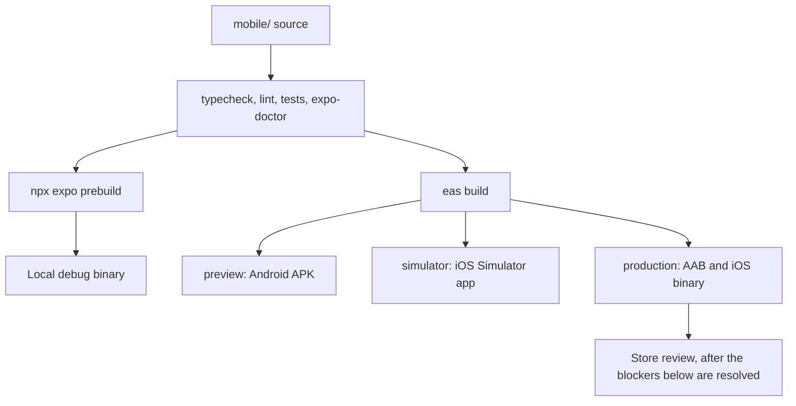

# Data For Dummies mobile release

Written 14 October 2026. The app lives in [`mobile/`](../mobile/). Behaviour is in [`MOBILE_ARCHITECTURE.md`](MOBILE_ARCHITECTURE.md).

No store listing, TestFlight build, or Play track exists. The APK linked from the website is the older file in the Google Drive folder named by [`APK_RELEASE.md`](APK_RELEASE.md). This Expo app does not replace that file until a binary is actually built and the owner puts it there.

## Identity

| Field | Value |
|-------|--------|
| App name | Data For Dummies |
| Package id and iOS bundle id | `in.datafordummies.app` |
| Scheme | `datafordummies` |
| Version in `app.config.ts` | 1.0.0 (iOS build 1, Android versionCode 1) |
| Expo account, Apple team, Play console app | Not created for this id |

`eas.json` has three profiles and no submit credentials:

- `preview` builds an Android APK for internal install.
- `simulator` builds an iOS Simulator app and an Android APK.
- `production` builds an Android App Bundle and an iOS store binary. `autoIncrement` asks EAS to bump the build number. It does nothing until someone runs the build.

Signing material (keystore, `.p8`, provisioning profile) is not in Git. `mobile/.gitignore` excludes `ios/`, `android/`, and those files. Native projects are generated by `npx expo prebuild` when a local build needs them.



## Commands

From `mobile/`, with Node 24 (the version in `.github/workflows/ci.yml`):

```bash
npm ci
npm run typecheck
npm run lint
npm run test:ci
npm run doctor
```

A local binary, after Xcode or Android Studio is installed:

```bash
npx expo run:ios
npx expo run:android
maestro --device <serial> test maestro/onboarding.yaml
```

A cloud binary, after `npx eas-cli login` on an Expo account the owner controls:

```bash
npx eas-cli build --profile preview --platform android
npx eas-cli build --profile simulator --platform ios
npx eas-cli build --profile production --platform all
```

Local Android release builds were produced on 14 October 2026 with JDK 17:

- `mobile/android/app/build/outputs/apk/release/app-release.apk` (109,738,251 bytes; SHA-256 `147f00cc226326892ee64bbc2a72e062af9e311371da4d86d12cdfcda3466ba2`)
- `mobile/android/app/build/outputs/bundle/release/app-release.aab` (77,017,726 bytes; SHA-256 `378ff8b91dfb575766a08670630524fa92b2c591d1dc4225006a49f83d0de88e`)

The generated `android/` tree and binaries are ignored build output, not source
artifacts. The APK installed and cold-launched as `in.datafordummies.app` on
the stable Android 16 `CJS_API_36` emulator in 1,572 ms. The checked onboarding
Maestro flow passed and the app log contained no fatal exception or app ANR.
The same release APK and Maestro flow also passed on the Android 16
`CJS_TABLET_API_36` Pixel Tablet emulator at 2560×1600.
Before packaging, `npx expo export --platform android --clear` was used to
invalidate Metro's transform cache. This matters after dependency changes:
Gradle's native `clean` task alone does not guarantee that a stale JavaScript
transform is discarded.

An iOS Simulator binary was not produced. This Mac has only Apple Command Line
Tools; the owner cancelled the administrator prompt required to install full
Xcode. The iOS JavaScript bundle, config and cross-platform tests pass, but
`npx expo run:ios` remains an explicit handoff check after Xcode is installed.

## Store blockers

Do not submit this app for review until each of these is true. None of them is true on 14 October 2026.

1. **Billing.** The app does not sell Pro and does not open Razorpay. App Store guideline 3.1.1 (guidelines last updated 8 June 2026) requires in-app purchase to unlock digital content sold in the app. Google Play's payments policy requires Google Play billing for a digital subscription, unless a listed exception applies. Accessing a subscription bought on the website is allowed only inside the conditions of guideline 3.1.3(b), which also says those items are available as in-app purchases, or of the Play exception the owner is relying on. The owner has to choose that model and create the real product ids. The app has no placeholder product ids on purpose.
2. **Account deletion is in the app.** Account, then Delete account, asks for the password and the word DELETE, then calls `DELETE /v1/account`. A reviewer still has to see that screen on a device. The demo account cannot be deleted. An active Pro subscription is cancelled at Razorpay before the account goes; if that cancel fails, the account stays.
3. **Listing facts.** The store text can repeat what the site says: the courses that exist in this repository, free lessons, and Pro that is recognised if the account already has it. It cannot add learner counts, employer names, or a claim that a completion record is a vendor certificate.
4. **Domain.** `datafordummies.in` expires on 13 March 2027 and auto-renew is off. A store app that loads lessons from that host stops working with the domain.

## What a device check still has to cover

Static tests do not open a phone. Before calling a binary done, run through: cold start, the three onboarding slides, sign-up with a real code, a wrong code, the dummy sign-in, kill and relaunch, sign-out, a free lesson, a Pro lesson on an account without Pro, a Pro lesson on an account with Pro, a tool page, a dataset link, an off-site link, hardware back, and airplane mode. Compare the icon with `logo.png`.

Real email delivery, a real Razorpay charge, and store approval are account tests. Do not mark them passed from a local run.
